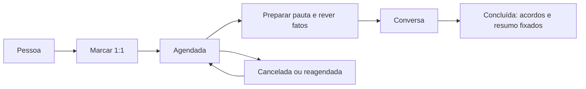

# Conversas 1:1 — proposta de produto, UX e implementação

## Propósito e decisão de escopo

Uma 1:1 deve ajudar gestor e colaborador a chegar preparados, conversar sobre objetivos e sair com acordos claros. A página responde, nesta ordem: **quando será a conversa**, **o que mudou desde a última conversa concluída** e **o que precisa de decisão agora**. Os números são atalhos para registros verificáveis, não uma nota de desempenho da pessoa.

No primeiro lançamento, o agendamento acontece **dentro da Promova**: data, hora, duração, fuso e local ou link. Ambas as pessoas veem a reunião no aplicativo. O gestor escolhe uma visão inicial de **7 ou 30 dias** para a primeira 1:1; a partir da segunda, o resumo usa a última conversa concluída. A repetição semanal ou mensal vem na etapa de cadência. Integração com calendário, convites externos, lembretes fora do aplicativo, transcrição e resumo por IA ficam para uma etapa posterior. A interface não deve prometer que um convite foi enviado a outro serviço.

O registro da conversa inclui pauta compartilhada, decisões e próximos passos. Não há campo de anotação privada no MVP. Isso simplifica a expectativa de visibilidade: tudo que for salvo na conversa é visível aos dois participantes. O gestor segue sendo o responsável pelo agendamento e por marcar a reunião como concluída; ambos podem sugerir temas e registrar contexto na pauta.

## Fluxo principal

1. Em **Pessoas**, o gestor abre a pessoa e escolhe **Marcar 1:1**. Também existe uma entrada **1:1** na navegação da gestão, com próximas conversas e conversas a preparar. O colaborador vê **Minhas 1:1** no próprio espaço.
2. O formulário mostra pessoa já selecionada, data/hora, duração padrão de 30 minutos, fuso visível, local/link opcional e uma pauta inicial opcional. Na primeira 1:1, o gestor escolhe **últimos 7 dias**, **últimos 30 dias** ou uma data inicial. Confirmação mostra o horário no fuso escolhido e, se diferente, no fuso local de quem está usando a tela.
3. A reunião criada aparece com estado **Agendada**. Ambos podem adicionar perguntas ou temas; o gestor pode reagendar ou cancelar, com confirmação clara e motivo opcional.
4. Ao abrir a reunião, a primeira dobra traz horário, participante e um cartão **Desde nossa última conversa**. Abaixo vêm fatos com links, pauta compartilhada e acordos anteriores. Um comando **Iniciar conversa** pode levar a uma visualização sem distrações, mas não altera o status da reunião.
5. Durante a conversa, os participantes registram decisões e próximos passos. Cada próximo passo tem texto, responsável e prazo opcional. O gestor encerra a reunião com **Concluir 1:1**. A conclusão fixa o recorte e o resumo que foi usado naquela conversa.
6. A reunião concluída permanece no histórico, com decisões, próximos passos e resumo do período. Um encontro cancelado ou não realizado não redefine a data de referência da próxima conversa.



## Tela da reunião

```text
← Voltar às 1:1                                  Agendada · 27 set, 14h
1:1 com Ana Costa                               [Reagendar] [Mais ações]
30 min · America/Sao_Paulo · Abrir link da reunião

DESDE A ÚLTIMA CONVERSA                          30 ago – 27 set · atualizado 10h42
[ 4 evidências capturadas ] [ 2 análises criadas ] [ 1 objetivo concluído ]
Fonte: registros disponíveis na Promova. [Ver todos os acontecimentos]

O QUE MUDOU
• Objetivo “...” concluído em 18 set                      [Abrir objetivo]
• Análise “...” recebeu pedido de contexto em 21 set     [Abrir análise]
• 2 evidências ainda aguardam análise                    [Ver evidências]

PAUTA COMPARTILHADA                              [Adicionar tema]
□ O que avançou no objetivo ...?
□ Que apoio ajudaria no próximo mês?

ACORDOS DA ÚLTIMA 1:1                           [Ver histórico]
□ Revisar proposta de ... · Ana · prazo 25 set

DECISÕES E PRÓXIMOS PASSOS                      [Adicionar acordo]
                                                   [Concluir 1:1]
```

No celular, os blocos ficam em uma coluna. Horário e ação principal permanecem acessíveis; os três números são cartões compactos, e listas longas usam **Ver todos**. A pauta e os acordos não ficam escondidos atrás de gráficos. No desktop, resumo e pauta podem formar duas colunas, preservando a ordem de leitura. Todos os controles precisam funcionar por teclado, ter foco visível e nome acessível. Estados de carregamento, erro e vazio são específicos de cada bloco, para que uma falha nas métricas não impeça a consulta da pauta.

### Texto e estados que evitam interpretações erradas

- Primeira reunião: **Ainda não houve uma 1:1 concluída. Mostrando os últimos 30 dias** por padrão, com troca rápida para **7 dias** ou data inicial personalizada. Esse ajuste vale só para o resumo da primeira reunião.
- Período sem registros: **Nenhuma atividade registrada na Promova nesse intervalo**. Não dizer que a pessoa não trabalhou.
- Fonte desatualizada: mostrar a última sincronização/captura disponível; um número zero não deve esconder falha de sincronização.
- Reunião atrasada: **Agendada para [data], ainda não concluída**; oferecer **Concluir**, **Reagendar** e **Marcar como não realizada**. Só **Concluir** avança a referência temporal.
- Sem objetivos ativos: mostrar isso como estado atual, fora da lista de acontecimentos do período.
- Cada cartão numérico deve abrir a lista filtrada pelos mesmos participante e intervalo, com caminho até a evidência, análise ou objetivo individual.

## Definição do resumo

Para a reunião `M`, o início é `completed_at` da **última reunião concluída do mesmo par gestor–colaborador** antes de `M`. O fim é o instante de preparação da reunião, até sua conclusão; após concluída, é o `completed_at` de `M`. O intervalo é **[início, fim)** para evitar dupla contagem entre conversas. Antes da primeira conclusão, usar a janela inicial descrita acima e persistir a escolha feita pelo gestor. Cancelamentos, reagendamentos e reuniões não realizadas não mudam o início. O fuso é usado para exibição e seleção de datas; a consulta usa instantes UTC.

O resumo ao vivo é recalculado ao abrir a página e exibe **Atualizado em**. Na conclusão, guardar `window_start`, `window_end`, `generated_at`, versão da fórmula, contagens e IDs dos fatos mostrados. Isso preserva o que os participantes viram, mesmo que uma fonte seja sincronizada depois. Caso cheguem registros atrasados, a reunião histórica mantém o retrato original; o detalhe da fonte continua acessível conforme permissão atual.

| Bloco | Regra de contagem | Interpretação na tela |
| --- | --- | --- |
| Evidências capturadas | Evidências da pessoa com `captured_at` no intervalo; uma por ID. | Registros que passaram a estar disponíveis na Promova. `occurred_at` pode ser anterior e aparece no detalhe. |
| Análises criadas | Análises salvas com `created_at` no intervalo. | Novas análises, sem somar novamente as evidências que as originaram. |
| Revisões feitas | Eventos de `saved_analysis_reviews.created_at` no intervalo; mostrar também análises distintas. | Ações de revisão do gestor, distintas de code review no GitHub. |
| Objetivos alterados | Objetivos distintos com evento em `career_objective_events.occurred_at` no intervalo, agrupados por transição para concluído, reativação e mudança de prazo. | Mudanças verificáveis desde a conversa; texto do objetivo pode ter sido editado sem histórico textual e não deve ser descrito como mudança histórica. |
| Pendências atuais | Objetivos ativos vencidos, análises atualmente sem revisão ou aguardando contexto, acordos abertos. | Situação **de hoje**, apresentada em seção separada dos eventos do intervalo. |
| PRs capturados | Apenas fatos `github_pull_requests` associados à pessoa, com `last_synced_at` e datas de evento apropriadas; mostrar depois dos sinais de carreira. | Cobertura parcial da integração, sem inferir produtividade ou qualidade. |

Ordenar **O que mudou** por relevância para a conversa: acordos vencidos, objetivo concluído ou com prazo alterado, revisão que pede contexto, novas análises e evidências recentes. Limitar a prévia a cinco itens, com **Ver todos** e paginação no detalhe. Mostrar data, tipo, título curto e link. Evitar ranking entre pessoas, pontuação de produtividade, interpretação automática de humor e resumos narrativos que atribuam causalidade sem confirmação humana.

## Dados e contratos sugeridos

Criar uma migração após `V11` com:

- `one_on_one_series`: `id`, `manager_user_id`, `employee_user_id`, `cadence` (`ONCE`, `WEEKLY`, `MONTHLY`), `weekday` ou dia do mês, `local_time`, `time_zone`, `duration_minutes`, `location_url`, `active`, `created_at`, `updated_at`. Para recorrência mensal em dia 29–31, usar o último dia do mês quando necessário e explicar isso no formulário.
- `one_on_one_meetings`: `id`, `series_id` opcional, par de usuários, `scheduled_start_at`, `scheduled_end_at`, `initial_window_start` opcional, `status` (`SCHEDULED`, `COMPLETED`, `CANCELLED`, `MISSED`), `completed_at`, `cancel_reason`, `version`, `created_at`, `updated_at`. Índices por par e horário; restrição de uma ocorrência por série e horário original para evitar duplicatas.
- `one_on_one_topics`: `id`, `meeting_id`, `author_user_id`, `text`, `sort_order`, `resolved_at`, timestamps. Texto e autoria visíveis aos dois.
- `one_on_one_actions`: `id`, `meeting_id`, `owner_user_id`, `text`, `due_date`, `completed_at`, timestamps. Ações abertas aparecem na preparação da próxima reunião do mesmo par.
- `one_on_one_summary_snapshots`: `meeting_id` único, janela, geração, versão de cálculo e JSON estruturado de contagens/IDs. Não copiar o texto integral de evidências nem de análises para o snapshot.

As alterações de pauta, acordos e reunião usam `version` ou `expectedUpdatedAt` para avisar quando a outra pessoa editou o registro. Criação e conclusão usam chave de idempotência para evitar encontros ou snapshots duplicados após repetição de requisição. Na conclusão, gravar status, horário e snapshot em uma transação. A recorrência cria ocorrências de forma determinística, com horizonte curto e geração idempotente; reagendar uma ocorrência não desloca toda a série.

API proposta, mantendo a convenção atual de `/manager` e endpoints próprios do colaborador:

| Método e rota | Uso |
| --- | --- |
| `GET /manager/one-on-ones?employeeId=&status=&page=` | Próximas reuniões e histórico no escopo do gestor. |
| `POST /manager/one-on-ones` | Agendar encontro avulso ou série, validando vínculo ativo com a pessoa. |
| `GET /manager/one-on-ones/{id}` | Reunião, pauta, acordos e resumo. |
| `PATCH /manager/one-on-ones/{id}` | Reagendar, cancelar ou marcar como não realizada. |
| `POST /manager/one-on-ones/{id}/complete` | Concluir e fixar snapshot. |
| `GET /manager/one-on-ones/{id}/activity?page=` | Acontecimentos do intervalo, paginados, com links. |
| `POST/PATCH /one-on-ones/{id}/topics` | Pauta compartilhada, acessível aos dois participantes. |
| `POST/PATCH /one-on-ones/{id}/actions` | Acordos compartilhados, com autoria e responsável. |
| `GET /one-on-ones` e `GET /one-on-ones/{id}` | Visão do colaborador. |

No backend, reutilizar `ManagerTeamService.requireVisible` em toda operação do gestor e verificar o par da reunião no banco, inclusive no detalhe e nas mutações. O colaborador acessa somente reuniões em que `employee_user_id` é o próprio ID. Ao mudar de equipe, o gestor anterior perde acesso; o novo gestor não herda notas do par anterior. O colaborador mantém acesso ao próprio histórico compartilhado. Links para evidências ou análises continuam sujeitos à autorização dos endpoints de destino. Evitar vazamento por contagem, busca ou mensagem de erro: recurso fora do escopo responde 404.

No frontend, acrescentar rotas de lista e detalhe em `frontend/router.mjs`, chamadas em `frontend/services/api.mjs` e módulos de renderização próprios, integrados a `frontend/app.mjs`. Reaproveitar cartões, listas, formulários e estados de erro atuais. Não usar o `managerDashboard` filtrado como API da reunião: ele agrega a equipe e mistura acontecimentos do período com pendências atuais. O resumo da 1:1 precisa de endpoint por pessoa, janela vinculada à conversa e fatos navegáveis.

## Entrega em etapas

1. **Núcleo útil:** agendar encontro avulso, listar para ambos, pauta compartilhada, resumo do intervalo, acordos, conclusão e histórico. Esse recorte já permite preparar e conduzir uma 1:1 de ponta a ponta.
2. **Cadência:** séries semanais e mensais, reagendamento de ocorrência, próxima conversa e alertas dentro da Promova para preparação e acordos próximos do prazo.
3. **Integrações:** calendário e notificações externas mediante escolha de provedor, consentimento e tratamento explícito de falhas de sincronização. IA, se adicionada, sugere uma pauta revisável e cita os fatos; nunca publica decisões automaticamente.

## Critérios de aceite

- Gestor só agenda para subordinado com vínculo ativo; funcionário e outro gestor não conseguem abrir ou alterar essa reunião por URL ou API.
- Agendamento, reagendamento, cancelamento, encontro não realizado e conclusão exibem o estado correto aos dois; somente a conclusão move a referência do próximo resumo.
- O período da tela e da lista de fatos é idêntico. Dois encontros consecutivos não contam o mesmo evento duas vezes. Primeiro encontro e período sem dados têm explicação clara.
- Cada número é reproduzível pelos registros e abre o detalhe correspondente. Pendências atuais são rotuladas separadamente. Uma captura tardia não altera o snapshot de uma reunião já concluída.
- Pauta e acordos sobrevivem a recarga, indicam responsável e prazo, e lidam com edição simultânea sem perda silenciosa.
- Em 320 px e com teclado, é possível agendar, consultar o resumo, adicionar tema/acordo e concluir. Campos têm rótulos, erros inline e foco levado ao erro ou ao novo conteúdo.
- A tela é utilizável quando não há reunião anterior, objetivo, evidência ou integração GitHub. Falha no cálculo de atividade não bloqueia a pauta nem os acordos.

## Indicadores de produto

Medir tempo para preparar uma conversa, proporção de 1:1 concluídas com ao menos um tema ou acordo, abertura dos fatos a partir do resumo e continuidade dos acordos na reunião seguinte. Não usar contagens de atividade como avaliação de desempenho do colaborador.
